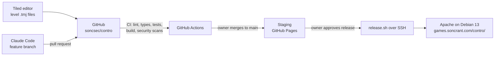

# Contro — Architecture

> **Status:** ADR-C01 to ADR-C09 accepted by owner 2026-10-17.

Contro reuses the platform decisions already made for Star Destroyer and the games portal. Those are recorded in `~/dev/games/stardestroyer/ARCHITECTURE.md` (ADR-001 to ADR-011) and are not repeated here. This file records how they apply to Contro, and the decisions that are new for a platformer.

## 1. Overview

Contro is a **static website**: HTML, JavaScript, images and audio, with no backend. It is served by the existing Apache server at `games.soncrant.com/contro/`.



| Item | Value |
|---|---|
| Repo | `soncsec/contro` (public) |
| Local folder | `~/dev/games/contro/` |
| Slug and URL | `contro`, `games.soncrant.com/contro/` |
| Production files | `/var/www/html/soncrant.com/pub/games/contro` → `/srv/games-releases/contro/<id>/` |
| Ports | dev **5174**, preview **4175**, Playwright **4176** |
| Staging | `https://soncsec.github.io/contro/` |

## 2. Inherited decisions

| Star Destroyer ADR | How it applies to Contro |
|---|---|
| ADR-001 Static, no backend | Same. localStorage for progress, best score and settings |
| ADR-002 Phaser 4.2.1 | Same version, pinned exactly |
| ADR-003 TypeScript 6.0.3 | Same, with the same strict compiler options |
| ADR-004 Vite 8.3.2, `base: './'` | Same |
| ADR-005 Pages staging, Apache production | Same |
| ADR-006 Logic separate from Phaser, Vitest, Playwright, seeded RNG | Same |
| ADR-007 Security tooling | Same: CodeQL, ESLint, `npm audit`, Dependabot, Gitleaks, ZAP |
| ADR-009 Release script over SSH | Same script, with the slug locked to `contro`. The owner gave standing approval (2026-10-17) for Claude to release each playable increment; the CI and ZAP gates are unchanged |
| ADR-010 HTTP on port 80 | Same (owner decision) |
| ADR-011 Parallel instances | Contro is the first game built alongside Star Destroyer. It copies Star Destroyer's setup by hand because the template (T1) doesn't exist yet (ADR-C09) |

## 3. Decisions for Contro

### ADR-C01: Levels authored in Tiled — *Accepted*

| | **Tiled → JSON** (chosen) | Levels as text grids in TypeScript | LDtk editor |
|---|---|---|---|
| Editing three large layered levels | Visual, fast | Slow and error-prone | Visual, fast |
| Phaser support | Built in (`load.tilemapTiledJSON`) | Custom parser | Third-party loader or custom code |
| New runtime dependency | None | None | Likely one |
| Tooling cost | Free desktop app on the dev machine (Debian package) | None | Desktop app |

- **Decision:** levels are made in **Tiled** and saved as `.tmj` (JSON) in `public/assets/levels/`, with the tileset embedded (Phaser cannot load external tilesets). Each map has a `background` tile layer, a `collision` object layer of `solid` and `platform` rectangles, and a `spawns` object layer (player start, enemies, exit; later checkpoints, triggers and the boss arena). The full contract is in `src/logic/levelMap.ts`.
- **Collision as rectangles (M1.2, 2026-10-17):** collision is drawn as rectangles rather than marked on tiles, because the Warped room sections reuse the same tiles for walls and floor and draw the floor in perspective. Rectangles keep collision independent of the art.
- **Tools:** `tools/levels/new_corridor_room.py` makes a first version of a map from corridor room sections; after that the `.tmj` is the source of truth. `tools/levels/render_map.py` renders a map with its collision and spawns marked, for PR screenshots.
- **Guard rail:** a unit test loads every map and checks it: required layers exist, every object type is known, every enemy type exists in the data files, there is exactly one player start and one exit, and tilesets point to files that exist in `public/assets/`.
- **Tradeoffs:** Tiled map files are large, so diffs are hard to review by eye. PRs that change a map include a screenshot.

### ADR-C02: Physics — Phaser Arcade — *Accepted*

- **Alternatives:** Matter.js (full rigid-body physics, also built into Phaser).
- **Decision:** Arcade physics: box collisions, tile collisions, and one-way platforms (collide only from above). Run-and-gun movement is box-based; Matter's realistic physics is heavier and harder to make feel snappy.
- **Movement rules:** acceleration, jump speed, gravity, coyote time and jump buffering are plain functions in `src/logic/`, unit tested, with all numbers in `src/config/tuning.ts`.

### ADR-C03: Content as validated data — *Accepted*

- **Decision:** enemy types, boss phases, weapon definitions and dialogue cards are TypeScript data objects in `src/data/`, checked by unit tests (valid references, numbers within limits). One shared game scene plays any level. This extends Star Destroyer's proposed ADR-012.
- **Alternatives:** hand-coded scenes per level.
- **Tradeoffs:** the formats need designing early (M1–M3), but levels 2 and 3 then become mostly data, art and map work.

### ADR-C04: Animation and aim frames — *Accepted*

- **Decision:** each animation, including each aim pose, is one entry in `src/assets/manifest.ts` (key, file, frame size, frame count, frame rate, loop, muzzle offset), as in Star Destroyer. Sprite sheets stay as individual PNGs; no packed atlas.
- **Derived art:** frames Claude creates (for example the diagonal-up marine) are produced by a script in `tools/art/` from the original legacy files, so they can be regenerated and reviewed. The output PNG is committed and credited as derived from the original.
- **Tradeoffs:** a few more HTTP requests than an atlas; acceptable for about 100 small files. Swapping in better aim art is a manifest change.

### ADR-C05: Screen size and scaling — *Accepted; 320×176 confirmed in M1.2*

- **Decision:** an internal resolution of **320×176** (the corridor tileset's room sections are exactly 176 px tall), scaled by whole numbers, with `pixelArt: true` and `roundPixels: true`. 176 px is the native height of most Warped backgrounds.
- **Alternatives:** 256×240 (NES-like, but the backgrounds would need stretching or filler), 384×216 (more view, more empty space).

### ADR-C06: Audio — *Accepted*

- **Decision:** Phaser WebAudio with **OGG** files (Chrome and Firefox both support it). Sound effects and one music loop per level from CC0 sources, each approved by the owner and listed in `CREDITS.md`. Audio is unlocked on the first key press or button press, as browsers require.
- **Alternatives:** MP3 (larger for the same quality), OGG plus M4A (only needed for Safari, not a v1 target).
- **Limits:** every file under the repo's 5 MB limit; music loops kept short (around 1–2 MB).

### ADR-C07: Input — keyboard and gamepad — *Accepted*

- **Decision:** one input layer maps keys and gamepad buttons to actions (`left`, `right`, `jump`, `fire`, `aimUp`, `crouch`, `pause`). Game code reads actions only. Gamepads use the browser's standard mapping. The action mapping is a pure function and unit tested.
- **Alternatives:** reading keys directly in scenes (couples gameplay to devices and blocks testing).

### ADR-C08: Saved data — *Accepted*

- **Decision:** one versioned localStorage key (`contro.save.v1`) holding furthest level, best score and volume. Reads are validated and fall back to defaults if storage is missing, blocked or corrupt.

### ADR-C09: Repo setup copied from Star Destroyer — *Accepted*

- **Decision:** copy Star Destroyer's scaffold, CI workflows, security checks, test setup and release scripts into this repo and adapt the slug, ports and docs. Differences that would help every game are listed in `TEMPLATE-NOTES.md` for the template task (Star Destroyer T1).
- **Alternatives:** wait for `soncsec/game-template` (blocks Contro on unstarted work).
- **Tradeoffs:** later improvements to Star Destroyer's setup must be copied by hand.

## 4. Code structure

```
contro/
├── public/assets/           sprites, tilesets, levels (.tmj), audio — copied from legacy/, listed in CREDITS.md
├── src/
│   ├── main.ts              Phaser config and scaling
│   ├── config/tuning.ts     every gameplay number
│   ├── assets/manifest.ts   every sheet and animation
│   ├── data/                enemies, bosses, weapons, dialogue
│   ├── logic/               pure rules: movement, damage, weapons, checkpoints, save, input mapping (no Phaser)
│   ├── scenes/              Preload, Title, Level, Dialogue, Pause, GameOver, Ending, AssetPreview
│   ├── entities/            Player, enemies, bosses, bullets, pickups (pooled)
│   └── debug/testHook.ts    e2e-only test hook (window.__contro)
├── tests/unit/ tests/e2e/ tests/release/
├── tools/art/               scripts that derive new frames from legacy art
├── scripts/                 check_repo.py, release.sh, release-remote.sh, smoke_test.py, zap_check.py
└── PROJECT.md ARCHITECTURE.md ROADMAP.md CLAUDE.md CREDITS.md TEMPLATE-NOTES.md
```

## 5. Key practices

- **Pixel-perfect rendering:** whole-number scaling, `image-rendering: pixelated` in `src/style.css` (no inline styles because of the CSP).
- **Object pooling** for bullets, enemies, effects and pickups.
- **Test hook:** `src/debug/testHook.ts` exposes `window.__contro` (scene, player state, spawn and teleport controls) in the e2e build only (`vite build --mode e2e`). CI checks that the staging build does not contain it. Tests still use real keyboard input for movement.
- **Determinism:** seeded RNG (`?seed=`) for anything random in gameplay.
- **Dependencies:** runtime dependency is Phaser only. Exact versions, at least two weeks old, committed lockfile; new dependencies need owner approval.

## 6. Delivery pipeline

Same as Star Destroyer: feature branch → PR with evidence → CI (format, lint, typecheck, unit tests with coverage, Playwright in Chromium and Firefox, build, `npm audit`, CodeQL, Gitleaks, repo checks) → owner merges → staging on GitHub Pages plus ZAP scan → owner approves → `scripts/release.sh deploy` → smoke test with automatic rollback.

## 7. Development environment

- Debian 13 dev machine; Node.js 24.21.0 via nvm; GitHub CLI at `~/.local/bin/gh`.
- Tiled map editor (Debian package `tiled`), installed by the owner.
- Production server details live in the untracked `deploy/server.env`, never in the repo.
